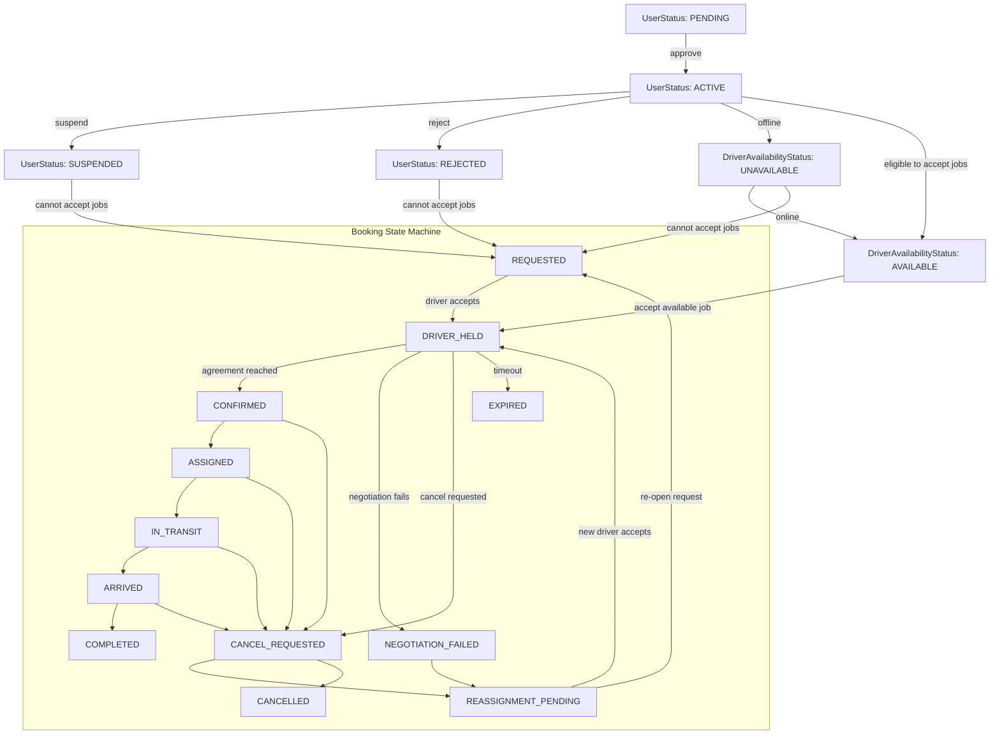

# Ambulance Booking and Driver Registration State Specification

## 1. Purpose

This document defines the operational state model for:

- booking lifecycle
- driver registration/account lifecycle
- driver availability lifecycle
- interaction rules between booking state and driver registration state

The goal is to make the system safe, simple, and resilient when a driver accepts by mistake, a price negotiation fails, a cancellation is requested, or a driver account is temporarily unavailable.

This model is designed around the current backend conventions used in the project:

- `BookingStatus`
- `UserStatus`
- `DriverAvailabilityStatus`

## 2. Core status entities

### 2.1 Booking lifecycle

The booking state model currently includes:

- `REQUESTED`
- `DRIVER_HELD`
- `NEGOTIATION_FAILED`
- `REASSIGNMENT_PENDING`
- `CONFIRMED`
- `ASSIGNED`
- `IN_TRANSIT`
- `ARRIVED`
- `COMPLETED`
- `CANCEL_REQUESTED`
- `CANCELLED`
- `EXPIRED`

These statuses represent the complete trip lifecycle from creation to closure, while preserving the safety requirement that a booking never silently disappears.

### 2.2 Driver registration lifecycle

The driver/user account lifecycle is:

- `PENDING` - account created, not yet approved
- `ACTIVE` - approved and can receive jobs
- `SUSPENDED` - temporarily blocked
- `REJECTED` - permanently not approved

This status is tracked on the `User` entity and controls whether the driver is allowed to participate in dispatch operations.

### 2.3 Driver availability lifecycle

Driver operational availability is separate from registration status:

- `AVAILABLE` - driver is online and free to accept jobs
- `UNAVAILABLE` - driver is offline or not currently accepting work

A driver may be `ACTIVE` but still `UNAVAILABLE` for operational reasons. The system should only consider drivers available for assignment when both rules are true:

- `user.status == ACTIVE`
- `user.availabilityStatus == AVAILABLE`

## 3. Safety principles

1. No silent disappearance of a trip
   - A booking should not vanish from the system when a driver cancels or a negotiation fails.
   - It must move to a follow-up state such as `NEGOTIATION_FAILED` or `REASSIGNMENT_PENDING`.

2. Driver accept is provisional
   - A driver can temporarily hold a booking, but the booking is not final until confirmed or assigned.
   - This protects against accidental acceptance and prevents the requester from thinking the trip is covered when it is not.

3. Failed negotiation must re-open the request
   - If the driver and requester cannot agree, the system must release the booking back into circulation.

4. Cancellation is never silent voiding
   - When a booking is canceled before assignment, it should move into a reassignment flow rather than disappear.

5. Driver UX must stay simple
   - The driver sees a limited set of actions such as Accept, Confirm, Reject/Fail Negotiation, and Cancel Request.
   - Operational complexity is handled in the backend state machine.

## 4. Booking state definitions

### 4.1 `REQUESTED`

A booking has just been created and is waiting for driver attention.

Typical conditions:

- requester created a booking
- dispatch or web flow recognized it as active
- no driver is currently holding it

Transition rules:

- `REQUESTED -> DRIVER_HELD` when a driver accepts the booking
- `REQUESTED -> CANCELLED` only in exceptional direct refusal/cancel path if policy allows immediate cancellation
- `REQUESTED -> REASSIGNMENT_PENDING` when a prior hold is released for requeue
- `REQUESTED -> EXPIRED` if the booking is left unclaimed too long or timed out

### 4.2 `DRIVER_HELD`

A driver has accepted the trip and reserved it for a short period while negotiation or confirmation is still open.

This state is intentionally provisional.

Transition rules:

- `DRIVER_HELD -> CONFIRMED` once both sides agree
- `DRIVER_HELD -> NEGOTIATION_FAILED` when caller/driver cannot agree
- `DRIVER_HELD -> CANCEL_REQUESTED` if the driver or caller asks to cancel
- `DRIVER_HELD -> CANCELLED` if the cancellation becomes final
- `DRIVER_HELD -> EXPIRED` if the hold expires before confirmation

### 4.3 `NEGOTIATION_FAILED`

A price or coordination negotiation failed, so the booking is no longer considered active for the current driver.

Required behavior:

- booking must be re-opened for reassignment
- assigned driver is cleared for the request
- booking transitions to `REASSIGNMENT_PENDING` or back to `REQUESTED`

Transition rules:

- `NEGOTIATION_FAILED -> REASSIGNMENT_PENDING`
- `NEGOTIATION_FAILED -> REQUESTED` in simpler queue-driven implementations

### 4.4 `REASSIGNMENT_PENDING`

The booking has been released and is queued for another driver.

This is the system’s “safe requeue” state.

Transition rules:

- `REASSIGNMENT_PENDING -> REQUESTED` if the system wants to re-expose it as a new open request
- `REASSIGNMENT_PENDING -> DRIVER_HELD` when another driver accepts
- `REASSIGNMENT_PENDING -> CANCELLED` if the request is ultimately closed by the requester or dispatch

### 4.5 `CONFIRMED`

The booking is accepted and agreed by the driver and requester, but not yet active in movement.

This is a “ready to dispatch” state.

Transition rules:

- `CONFIRMED -> ASSIGNED` when dispatch finalizes the assignment
- `CONFIRMED -> CANCEL_REQUESTED` if cancellation is requested before departure
- `CONFIRMED -> CANCELLED` if the cancellation becomes final

### 4.6 `ASSIGNED`

The booking has been formally assigned to a driver and is now expected to proceed.

Transition rules:

- `ASSIGNED -> IN_TRANSIT`
- `ASSIGNED -> CANCEL_REQUESTED`
- `ASSIGNED -> CANCELLED`

### 4.7 `IN_TRANSIT`

Driver is en route to pickup or active transport.

Transition rules:

- `IN_TRANSIT -> ARRIVED`
- `IN_TRANSIT -> CANCEL_REQUESTED`
- `IN_TRANSIT -> CANCELLED`

### 4.8 `ARRIVED`

Driver reached patient/pickup site.

Transition rules:

- `ARRIVED -> COMPLETED`
- `ARRIVED -> CANCEL_REQUESTED`
- `ARRIVED -> CANCELLED`

### 4.9 `COMPLETED`

Trip is finished successfully.

Terminal booking state.

### 4.10 `CANCEL_REQUESTED`

A cancellation has been requested but not yet finalized.

This is essential for safe operational handling.

Transition rules:

- `CANCEL_REQUESTED -> REASSIGNMENT_PENDING` if a new assignment is needed after release
- `CANCEL_REQUESTED -> CANCELLED` when cancellation is finalized
- `CANCEL_REQUESTED -> ASSIGNED` or `CONFIRMED` in rare recovery cases depending on policy

### 4.11 `CANCELLED`

Canceled final state.

Terminal booking state for an intentionally canceled trip.

### 4.12 `EXPIRED`

Held reservation timed out before acceptance/confirmation.

Transition rules:

- `EXPIRED -> REASSIGNMENT_PENDING` so the request can be re-offered to another driver

## 5. Driver and booking interaction model

The most important system rule is that booking state and driver registration state are connected, but they are not the same concept.

### 5.1 Registration state gates access

A driver cannot access or receive rides unless their user record is in an eligible state.

Allowed driver state for dispatch:

- `UserStatus.ACTIVE`
- `DriverAvailabilityStatus.AVAILABLE`

Blocked driver state for dispatch:

- `PENDING`
- `SUSPENDED`
- `REJECTED`
- `UNAVAILABLE`

### 5.2 Booking availability query should consider both driver eligibility and booking status

The system should only expose a booking to a driver if:

- booking status is one of the open states, for example: `REQUESTED`, `REASSIGNMENT_PENDING`, `NEGOTIATION_FAILED`, or `CANCEL_REQUESTED` depending on flow
- assigned driver is null or the driver is the current hold owner
- the driver is `ACTIVE` and `AVAILABLE`
- driver does not already have an active trip

This is critical because a requeued trip must appear again in the driver UI after negotiation fails or a mistaken cancellation occurs.

### 5.3 Busy driver rules

A driver with an active trip should not be allowed to accept another booking. The current backend logic enforces this by checking active assigned trips.

Typical active trip states:

- `ASSIGNED`
- `CONFIRMED`
- `IN_TRANSIT`
- `ARRIVED`

If a driver has one of these states, they are considered occupied and unavailable for new claims.

## 6. Recommended driver workflow

The driver UI should remain simple. It should present only a few actionable states to the driver without exposing every operational backend state.

Recommended UI flow:

1. Driver sees a list of available jobs.
2. Driver taps `Accept`.
3. System sets booking to `DRIVER_HELD` and assigns the driver as provisional holder.
4. The driver can:
   - `Confirm` -> booking moves to `CONFIRMED`
   - `Fail Negotiation` -> booking moves to `NEGOTIATION_FAILED` and re-enters queue
   - `Cancel Request` -> booking moves to `CANCEL_REQUESTED`
5. After confirmation, the trip proceeds to `ASSIGNED`, `IN_TRANSIT`, `ARRIVED`, `COMPLETED`.

This keeps the interface simple while the backend preserves the correct safety behavior.

## 7. State transition diagram

## 8. Business rules by scenario

### 8.1 Driver accepts by mistake

If a driver accidentally accepts a request:

- booking moves from `REQUESTED` to `DRIVER_HELD`
- the booking is still not final
- the driver can either:
  - confirm it
  - fail negotiation
  - request cancellation
- if cancellation occurs, the booking should move to `CANCEL_REQUESTED` and then `REASSIGNMENT_PENDING` instead of disappearing

### 8.2 Negotiation fails

If the rider and driver cannot agree on price or trip conditions:

- booking moves to `NEGOTIATION_FAILED`
- assigned driver is released
- request is requeued so other drivers can see it again

This is the safest user experience in a no-human-monitoring environment.

### 8.3 Cancellation before assignment

A cancel request before actual dispatch should not erase the trip.

Instead:

- `REQUESTED` or `DRIVER_HELD` -> `CANCEL_REQUESTED`
- `CANCEL_REQUESTED` -> `REASSIGNMENT_PENDING`
- `REASSIGNMENT_PENDING` -> `REQUESTED`

This ensures the trip remains visible and can be accepted by another driver.

### 8.4 Driver account suspended or rejected

If the driver account is suspended or rejected:

- they cannot receive new bookings
- existing active bookings may be reassigned or canceled according to policy
- the system should prevent any new `DRIVER_HELD` assignment while user status is not `ACTIVE`

### 8.5 Driver unavailable/offline

If a driver is marked `UNAVAILABLE`:

- they should not appear in available-driver pools
- they should not receive booking offers
- once they return to `AVAILABLE`, they can rejoin the queue

## 9. Operational transition matrix

| Current state | Allowed next states | Notes |
| --- | --- | --- |
| `REQUESTED` | `DRIVER_HELD`, `REASSIGNMENT_PENDING`, `EXPIRED`, `CANCELLED` | open booking |
| `DRIVER_HELD` | `CONFIRMED`, `NEGOTIATION_FAILED`, `CANCEL_REQUESTED`, `EXPIRED` | provisional hold |
| `NEGOTIATION_FAILED` | `REASSIGNMENT_PENDING` | booking reopened |
| `REASSIGNMENT_PENDING` | `REQUESTED`, `DRIVER_HELD`, `CANCELLED` | requeue stage |
| `CONFIRMED` | `ASSIGNED`, `CANCEL_REQUESTED`, `CANCELLED` | ready for dispatch |
| `ASSIGNED` | `IN_TRANSIT`, `CANCEL_REQUESTED`, `CANCELLED` | formal assignment |
| `IN_TRANSIT` | `ARRIVED`, `CANCEL_REQUESTED`, `CANCELLED` | en route |
| `ARRIVED` | `COMPLETED`, `CANCEL_REQUESTED`, `CANCELLED` | at pickup |
| `CANCEL_REQUESTED` | `REASSIGNMENT_PENDING`, `CANCELLED` | cancellation pending |
| `EXPIRED` | `REASSIGNMENT_PENDING` | re-queue after timeout |

## 10. Design recommendations for implementation

1. Treat driver status and booking status as separate but linked dimensions.
   - Driver account status says whether the driver is allowed to participate.
   - Booking status says whether the request is still live and what stage it is in.

2. Do not allow new booking claims when driver is suspended or unavailable.

3. Requeue logic should be automatic and explicit.
   - `NEGOTIATION_FAILED` and `CANCEL_REQUESTED` must not remain hidden from driver job lists.

4. Keep the UI simple.
   - Driver-facing actions should not expose all internal statuses.
   - Backend handles the complexity.

5. Track `assignedDriver` and `status` together.
   - Any release from a hold must clear the assignment and move the booking into a safe requeue state.

## 11. Summary

The safest design is to treat trip acceptance as provisional, not final. A driver may accept, hold, negotiate, confirm, or request cancellation, but the booking must never silently vanish.

This is why the state machine includes `DRIVER_HELD`, `NEGOTIATION_FAILED`, `REASSIGNMENT_PENDING`, and `CANCEL_REQUESTED` as essential safety states.

At the same time, registration and availability are handled separately through `UserStatus` and `DriverAvailabilityStatus`, which determine whether the driver is even eligible to receive bookings.

That combination gives the system:

- safety under accidental acceptance
- automatic requeue when negotiations fail
- clean reassignment after cancellation
- consistent dispatch eligibility
- a simple and usable driver app

